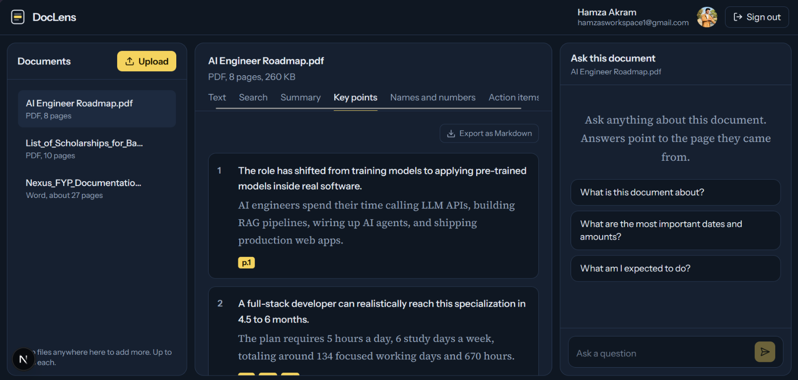
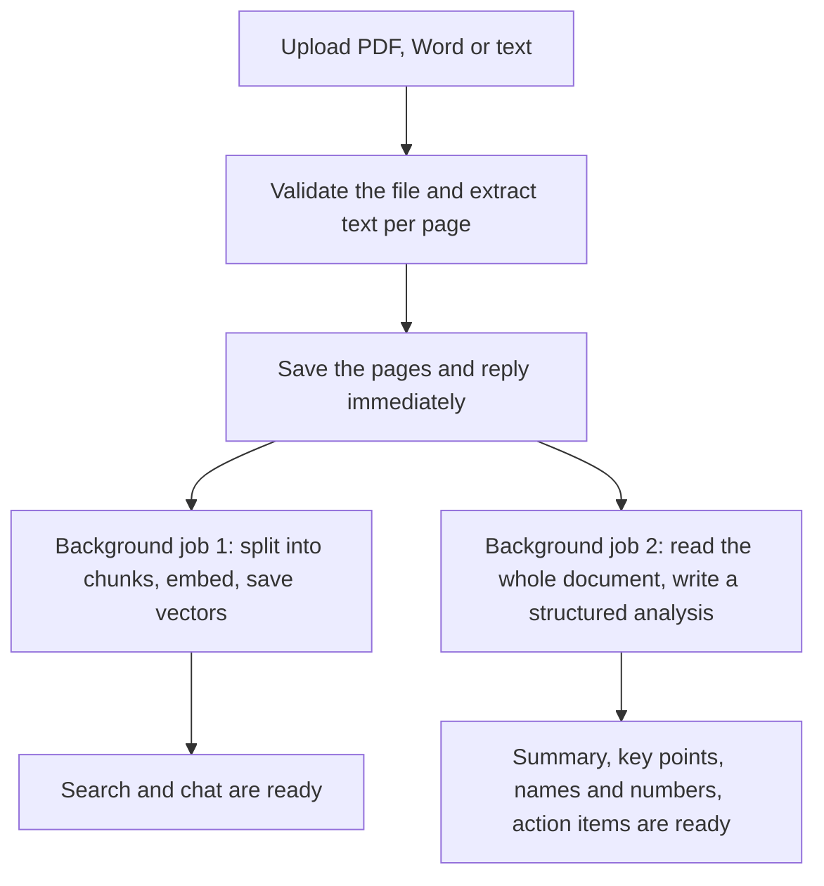
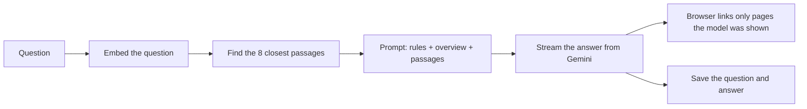

<div align="center">

# DocLens

**Upload a document. Read it, search it by meaning, get a structured analysis, and ask it questions.**  
**Every answer points to the page it came from, so you can check it.**

[](https://doclens-olive.vercel.app)


</div>



## Contents

[What it does](#what-it-does) · [What makes it careful](#what-makes-it-careful) · [How it works](#how-it-works) · [Tech stack](#tech-stack) · [Run it locally](#run-it-locally) · [Deploy](#deploy-to-vercel) · [Tests and tools](#tests-and-tools) · [Limits](#limits-and-honest-trade-offs) · [Project layout](#project-layout) · [Author](#author)

## What it does

| | |
|---|---|
| **Read** | A page-by-page viewer. PDFs keep their real pages. Word and text files are split into estimated pages, and the app says so. |
| **Search by meaning** | Ask in your own words and jump to the matching passages, not just exact keywords. |
| **Analysis** | A summary, key points, names and numbers (people, organizations, dates, amounts) and action items, each with the pages it came from. |
| **Chat with the document** | Streaming answers with clickable page citations. Conversations are saved per document. |
| **Export** | Download the analysis as a Markdown file. |

Supported files: PDF, Word (`.docx`) and plain text, up to 4 MB and 150 pages.

## What makes it careful

Plenty of tools let you "chat with a PDF". These are the parts of DocLens built to make the answers checkable and the app hard to break.

- **Citations you can trust.** The model is told which pages it may cite. The browser turns a `[p.8]` marker into a link only if page 8 was really in the model's context, so an invented page number never becomes a link.
- **Names and numbers are verified.** After the model lists a name, date or amount, the server looks for that exact wording on the cited page. Anything it can't find is flagged in the UI ("check the cited page").
- **Jobs fail independently.** Preparing a document for search and analyzing it are two background jobs with their own status. If one fails, the other still works, and a failed analysis can be retried without re-uploading.
- **A backup model.** If the main Gemini model is down, rate limited or silent, the request moves to a second model. This was added after a real outage during development.
- **Fair-use limits.** Uploads, questions and re-analyses are counted per person and for the whole site with an atomic database counter, so a burst of visitors can't use up the free AI quota for everyone. Sign-in and sign-up are rate limited too.
- **Untrusted text stays data.** Document text is wrapped in tags the document can't close, and the model is told to ignore instructions found inside it.
- **Tested.** 68 automated tests cover the retry logic, the backup model, streaming, citations, the usage limiter (including 30 simultaneous requests) and the database code against a real MongoDB.

## How it works

**When you upload a file**



**When you ask a question**



Search is a dot product over one document's vectors (a few hundred chunks), which takes milliseconds, so there is no vector database or Atlas Vector Search index to run. Vectors are stored as BSON float32 so adding an index later needs no migration.

## Tech stack

| Layer | Choice |
|---|---|
| Framework | Next.js 16 (App Router, Cache Components), React 19, TypeScript |
| Styling | Tailwind CSS 4 |
| Auth | Better Auth: email and password, optional Google sign-in, MongoDB adapter |
| Database | MongoDB Atlas (free tier) |
| Parsing | `unpdf` for PDF, `mammoth` for Word |
| AI | Vercel AI SDK with Google Gemini: a main and a backup chat model, and `gemini-embedding-001` (768 dimensions). Models are set in `lib/ai/config.ts` |
| Hosting | Vercel (Hobby) |

## Run it locally

You need Node 20.6 or newer, a free [MongoDB Atlas](https://www.mongodb.com/atlas) cluster and a free [Google AI Studio](https://aistudio.google.com/apikey) key.

```bash
git clone https://github.com/hamzaworkspace786/Doclens.git
cd Doclens
npm install
cp .env.example .env.local     # then fill it in (see the table below)
npm run dev                    # http://localhost:3000
```

### Environment variables

| Variable | Required | Purpose |
|---|---|---|
| `MONGODB_URI`, `MONGODB_DB` | yes | Atlas connection string and database name |
| `BETTER_AUTH_SECRET` | yes | Signs sessions. Use a long random value |
| `BETTER_AUTH_URL` | yes | The address the app runs at (`http://localhost:3000` locally) |
| `GOOGLE_GENERATIVE_AI_API_KEY` | yes | Powers analysis, search and chat |
| `GOOGLE_CLIENT_ID`, `GOOGLE_CLIENT_SECRET` | no | Google sign-in. Redirect URI: `<BETTER_AUTH_URL>/api/auth/callback/google` |
| `CRON_SECRET` | production | Protects the daily cleanup route (see below) |
| `TEST_MONGODB_URI` | tests only | A separate MongoDB that the database tests may create and delete |

## Deploy to Vercel

1. Push the repo and import it in Vercel.
2. Add every variable from the table above. Set `BETTER_AUTH_URL` to your real address, and use a new random `BETTER_AUTH_SECRET` and `CRON_SECRET`.
3. In Atlas, under Network Access, allow `0.0.0.0/0`. Vercel has no fixed IP address, so use a strong database password.
4. For Google sign-in, add `https://YOUR-APP/api/auth/callback/google` as an authorized redirect URI and your address as an authorized JavaScript origin.
5. Redeploy after changing variables.

`vercel.json` schedules `/api/cron/cleanup` once a day. It deletes documents older than 14 days so the free database can't fill up. The route only runs when the request carries `CRON_SECRET`, which Vercel sends automatically.

Check `https://YOUR-APP/api/health`: it answers `{"ok":true,...}` when the app and database are up.

## Tests and tools

```bash
npm run test:unit      # no database needed: analysis, chat, citations, export
npm test               # also runs the database tests (needs TEST_MONGODB_URI)
npm run load-test -- --url https://YOUR-APP --ramp   # GET-only load test of your own deployment
npm run check-models   # which Gemini models answer quickly on your key right now
```

The database tests create and delete a database named `doclens_test` and refuse to run against any other name.

## Limits and honest trade-offs

- **Free tiers.** DocLens runs on free quotas, so each person gets a daily allowance (see `LIMITS` in `lib/constants.ts`) and the site has one too. When it runs out, the app says so.
- **Privacy.** Document text is sent to Google's Gemini API, and Google's free-tier terms allow it to use submitted content to improve its products. Don't upload confidential files. See [`/privacy`](https://doclens-olive.vercel.app/privacy).
- **Files.** Scanned PDFs without selectable text are rejected; there is no OCR. The 4 MB limit comes from Vercel's request size limit on the free plan. Larger files would need direct-to-storage uploads.
- **Retention.** Documents are deleted after 14 days.
- **No email verification.** Sending verification emails to arbitrary addresses needs a domain you own. Sign-up is rate limited per IP instead.
- **Answers come from the 8 closest passages.** A question that needs the whole document ("list every date") can come back incomplete. The Names and numbers tab reads the whole document.
- **No Content-Security-Policy header yet.** Basic security headers are set. A CSP needs its own careful pass.

Ideas for later: OCR for scanned PDFs, direct-to-storage uploads, a document review tab, email verification with a custom domain.

## Project layout

```
app/                  pages and API routes (documents, analysis, chat, export, health, cron)
components/           workspace panels (document list, analysis tabs, chat, page viewer)
lib/ai/               prompts, retry and backup-model logic, schemas, streaming chat
lib/documents/        upload validation, parsing, chunking, storage, search, export
lib/usage.ts          fair-use limits
tests/                automated tests
scripts/              load test and model check
```

## Author

Built by **Hamza Akram**, a full-stack developer working with Next.js and TypeScript.  
[LinkedIn](https://www.linkedin.com/in/hamzaakram786) · [GitHub](https://github.com/hamzaworkspace786)
